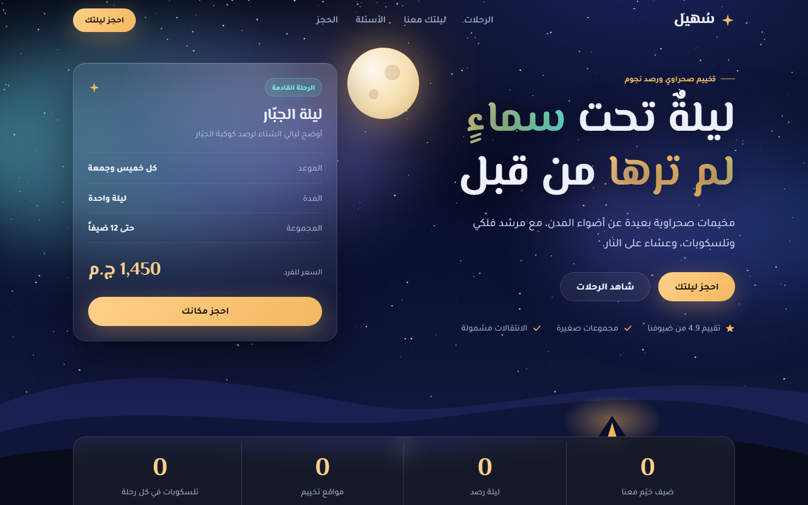
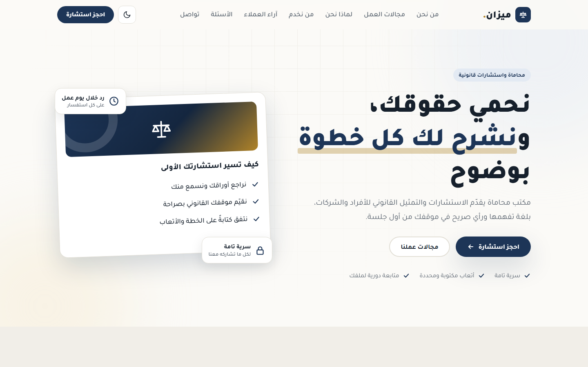
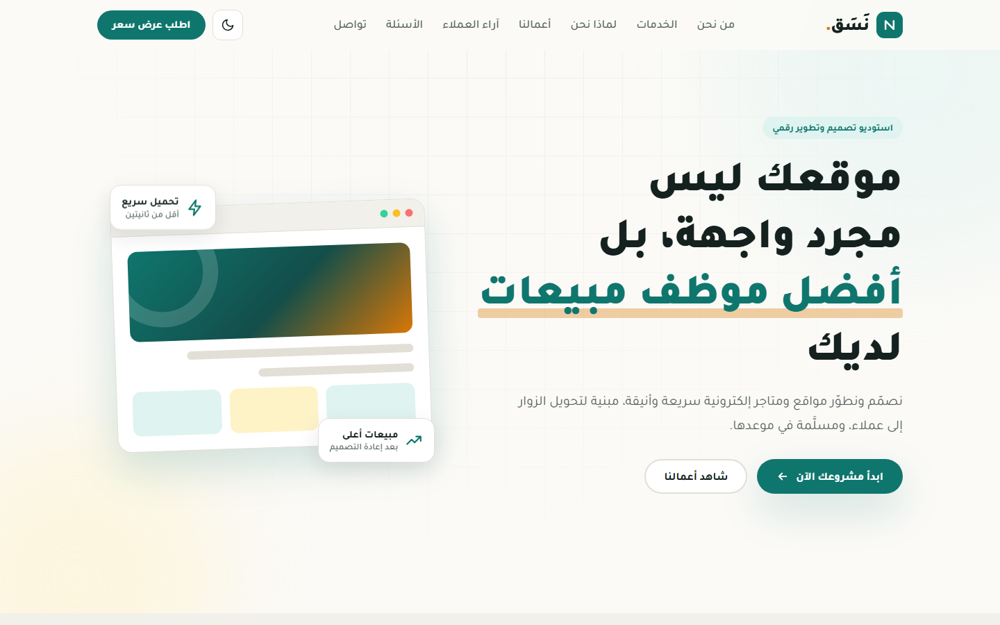

# Arabic Landing Pages — قوالب صفحات هبوط عربية مجانية، ومعها البرومبت

قوالب صفحات هبوط عربية (RTL)، كل قالب **ملف HTML واحد**: بدون مكتبات، بدون خطوات بناء، وبدون صور خارجية. ومع كل قالب **البرومبت** الذي يبني مثله في Claude لنشاطك أنت.

Free Arabic (RTL) landing page templates. Each one is a **single HTML file** with no frameworks, no build step and no external images, and each ships with the **prompt** to build your own version with Claude.

## القوالب — Templates

| القالب | المعاينة | الملف | البرومبت |
| --- | --- | --- | --- |
| **سُهيل** — سماء ونجوم سينمائية · Cinematic night sky | [Live](https://a7aadly1987-hub.github.io/arabic-landing-page/suhail/) | [`suhail/index.html`](suhail/index.html) | [suhail-night-sky.md](prompts/suhail-night-sky.md) |
| **ميزان** — مكتب محاماة · Law office | [Live](https://a7aadly1987-hub.github.io/arabic-landing-page/law/) | [`law/index.html`](law/index.html) | [business-landing.md](prompts/business-landing.md) |
| **نَسَق** — استوديو تصميم · Design studio | [Live](https://a7aadly1987-hub.github.io/arabic-landing-page/) | [`index.html`](index.html) | [business-landing.md](prompts/business-landing.md) |

| ميزان | نَسَق |
| --- | --- |
|  |  |

> **ملاحظة:** «سُهيل» و«ميزان» و«نَسَق» أسماء افتراضية للعرض فقط. الأرقام والأسعار والشهادات وبيانات التواصل كلها محتوى تجريبي يُستبدل ببيانات صاحب الموقع.
>
> **Note:** all three businesses are fictional. Numbers, prices, testimonials and contact details are placeholder content.

## طريقتان للاستخدام — Two ways to use

**1. خذ الملف وعدّله:** حمّل ملف القالب، افتحه في أي محرر، وغيّر النصوص. كل قسم يبدأ بتعليق مرقّم، والألوان متغيرات في `:root` أعلى الملف.

**2. ابنِ نسختك بالبرومبت:** افتح ملف البرومبت من مجلد [`prompts/`](prompts), املأ بيانات نشاطك بين الأقواس، والصقه في Claude.

Either download a template and edit the text, or open a prompt from [`prompts/`](prompts), fill in your business details and paste it into Claude.

## ما في كل قالب — What every template has

- ملف واحد يعمل بفتحه في المتصفح، بدون تثبيت
- عربي RTL من الأساس، بخطوط Google عربية
- متجاوب مع الموبايل والتابلت والديسكتوب، بدون تمرير أفقي
- حركات ظهور عند التمرير، مع احترام `prefers-reduced-motion`
- نموذج تواصل أو حجز بتحقق من المدخلات (لا يرسل لأي خادم؛ مكان الربط معلَّم في الكود)
- إمكانية وصول: HTML دلالي، تنقل بلوحة المفاتيح، `aria` وحالات focus واضحة
- وسوم SEO و Open Graph و favicon مضمّن

قالب «سُهيل» يضيف: نجوم وشهب على `canvas`، بارالاكس للكثبان، بطاقة زجاجية تميل مع الماوس، وكوكبة تُرسم عند الظهور. قالبا «ميزان» و«نَسَق» يضيفان وضعاً فاتحاً وداكناً مع حفظ الاختيار.

## خارطة الطريق — Roadmap

- [ ] عيادة — Clinic
- [ ] مطعم ومنيو — Restaurant & menu
- [ ] عقارات — Real estate
- [ ] متجر منتج واحد — Single-product store

عندك مجال تريد قالباً له؟ افتح [Issue](https://github.com/a7aadly1987-hub/arabic-landing-page/issues) باسم المجال. والمساهمات مرحّب بها: قالب جديد = مجلد فيه `index.html` واحد + ملف برومبت.

Want a template for another industry? Open an issue. Contributions welcome: one folder with a single `index.html`, plus its prompt.

## Author

Ahmed Hendawy — [DIMA Digital Studio](https://github.com/a7aadly1987-hub)

إذا أفادك المشروع، نجمة ⭐ تساعد غيرك على الوصول إليه.

## License

MIT
